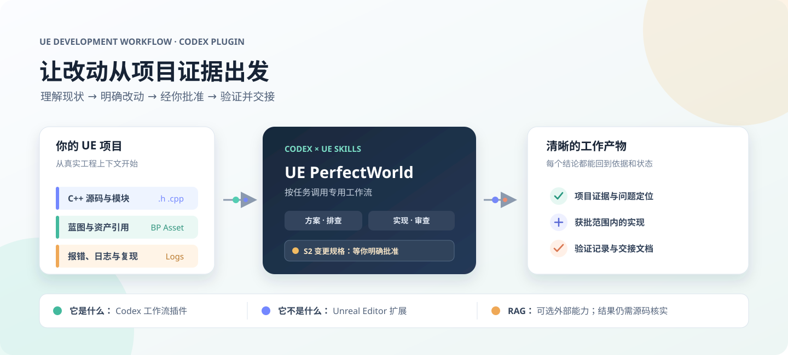
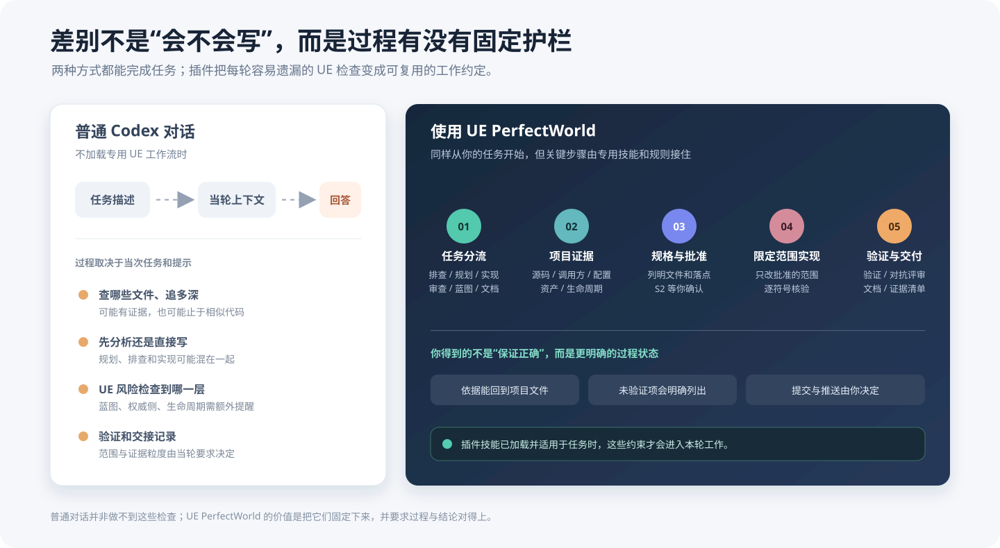
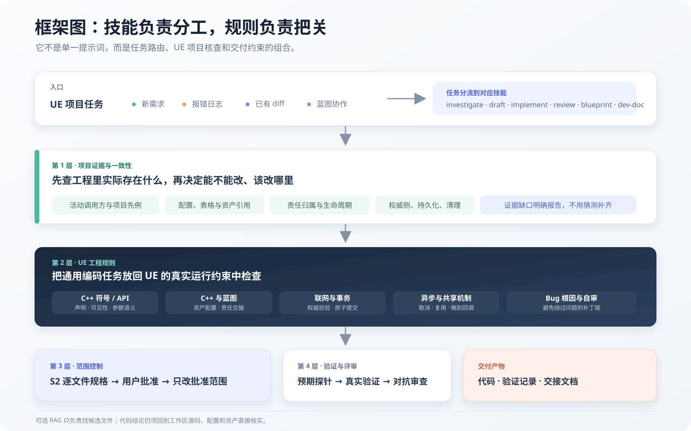
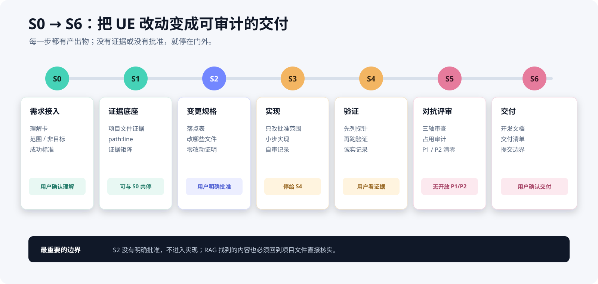

# UE PerfectWorld

让 UE 项目的需求、证据与实现，进入一套可检查、可交接的 Codex 工作流。

<p align="center">
  <a href="https://github.com/91pao/PerfectWorld/tags"></a>
  <a href="https://github.com/91pao/PerfectWorld/stargazers"></a>
  <a href="https://github.com/91pao/PerfectWorld/blob/main/LICENSE"></a>
  
  
</p>

<p align="center">
  
</p>

<p align="center">
  <a href="#快速上手"><strong>快速上手</strong></a> &nbsp; · &nbsp;
  <a href="#workflow-comparison">工作方式对比</a> &nbsp; · &nbsp;
  <a href="#plugin-framework">插件框架</a> &nbsp; · &nbsp;
  <a href="#stage-gates">S0-S6 门禁</a> &nbsp; · &nbsp;
  <a href="https://github.com/91pao/PerfectWorld/issues">反馈问题</a>
</p>

UE PerfectWorld 是给 **Codex** 使用的 Unreal Engine 项目工作流插件，面向 UE5 的 C++、蓝图及两者协作场景。它不只提供 UE 代码写法提示，而是把“理解项目、找到证据、决定改法、控制实现、验证结果、交接改动”连成一套明确的工作约定。

**它不是 Unreal Editor 扩展，也不包含 RAG 服务或索引器。** 插件不会因为安装就自动扫描或修改 UE 项目；项目文件仍按当前任务的授权和 S0-S6 门禁处理。

<a id="workflow-comparison"></a>
## 用插件和不用插件，差在哪？

普通 Codex 对话也可以完成 UE 开发任务。区别不是“一个会写代码、另一个不会”，而是这些项目检查和过程约束是否被预先定义、持续执行，并留下可以复核的产物。

<p align="center">
  
</p>

换句话说，**普通对话更灵活；在插件技能已加载并适用于当前任务时，UE PerfectWorld 会把容易遗漏的检查变成默认流程和停止条件。** 它不是保证代码正确的自动化工具，而是减少每轮重复说明、让关键检查和未验证事项更容易被看见。对很小的任务，可以缩短说明和产物，但不会跳过必要门禁。

<a id="plugin-framework"></a>
## 插件框架由什么组成

S0-S6 是流程骨架，但不是全部框架。真正影响代码怎么写的，是下面这些规则一起作用。

<p align="center">
  
</p>

图中的层次不是额外的审批阶段，而是同一项 UE 工作在进入实现前后需要经过的项目检查和代码约束。下面逐层展开说明。

### 1. 按任务类型分流，不把所有请求当成“写代码”

插件为不同工作定义了不同入口：已有症状先只读排查；需求还不清楚时先整理范围和规格；已有改动交给审查技能；只有通过批准门禁的方案才进入实现。蓝图协作和开发文档则在需要时作为专门能力参与。

这样可以减少两类常见错位：用户只想知道根因，回答却直接改文件；或者用户需要审查现有改动，回答却重新设计整套方案。每个技能都说明了它应该做什么、何时停止、哪些工作不属于它。

```text
                         +-- 已有症状 / 报错 --> 只读排查 --> 根因与证据
                         |
用户提出 UE 任务 --> 判断任务类型 +-- 需求不明确 --> 整理范围 --> 逐文件规格
                         |
                         +-- 已有代码改动 --> 独立审查 --> 问题与风险
                         |
                         +-- 方案已批准 --> 限定范围实现 --> 验证与交付

                    蓝图协作 / 开发文档按需接入
```

### 2. 结论必须落回当前项目证据

插件要求先从当前工作区寻找真实的类、调用方、配置和资产引用，再讨论 UE 项目应该怎样改。证据会尽量落实到 `path:line`；如果关键代码、蓝图资产或运行信息当前不可见，就报告具体缺口，而不是凭通用 UE 经验补出项目事实。

它也不会把“搜到一个相似类”当作可直接照搬的先例。需要比较它是否仍在使用、职责是否相同，以及所有权、生命周期和网络边界是否匹配。对跨系统需求，还要分别追清数据来源、触发、读取、持久化和清理。

```text
UE 项目问题
   |
   +--> 源码：类、实现、活动调用方
   +--> 配置：设置、表格、DataAsset
   +--> 资产：蓝图、组件、资源引用
   +--> 生命周期：创建、使用、持久化、清理
   |
   v
找到当前项目的直接证据？
   +-- 是 --> 记录 path:line --> 核对先例是否仍在用、职责是否匹配
   |
   +-- 否 --> 报告具体证据缺口，不用通用经验补成项目事实
                            |
                            v
                    基于证据形成结论
```

### 3. 先确认项目里谁负责，再决定把逻辑放哪

UE 功能经常横跨 C++、蓝图、DataAsset/DataTable、Subsystem 或共享组件。插件要求先画清责任和生命周期：谁创建状态、谁拥有状态、谁读取或消费、谁负责持久化、谁处理客户端与服务器边界、结束时由谁清理。

如果改动碰到共享组件、公共 API、对象池或异步资源流程，还要检查原有调用方与新调用方是否满足同一契约，包括初始化时机、缓存命中、失败、取消、复用和晚到回调。一次性异步完成通常应沿用事件、回调或项目既有通知，不默认用每帧 Tick 等待。

目标不是给每个功能都加一层框架，而是先找出现有职责归属；只有项目证据证明现有能力不满足需求，才提出扩展或新建机制。

```text
数据来源 --> 触发者 --> 状态创建者 --> 状态所有者 --> 读取 / 消费者
   |           |            |              |                  |
   +-----------+------------+--------------+------------------+
                                核对
                                 |
                 +---------------+----------------+
                 |               |                |
             谁来持久化？   客户端 / 服务端？   结束时谁清理？

异步 / 共享流程：
初始化 --> 缓存命中 / 未命中 --> 成功 / 失败 --> 取消 / 复用
                                  |
                                  v
                         晚到回调如何处理？
```

### 4. 写代码前做 UE 符号与接口查证

对将要直接写入工程或交付粘贴的代码，插件增加了专门的贴码门禁：检查新增符号是否冲突，确认既有成员的声明和可见性，从实现而不只是函数签名核实参数语义，并在同一模块寻找 include 写法先例。

改动规格会指出每个目标文件和落点；实现阶段按获批清单小步修改。交付前还要检查改名或删除的符号是否仍有引用，避免只给出“看起来合理”但实际无法编译或与项目契约不符的代码。

```text
待写代码
   |
   v
核对目标文件、落点与获批范围
   |
   v
查符号冲突、成员声明 / 可见性、函数实现中的参数语义
   |
   v
确认同模块 include 先例与调用契约
   |
   v
规格是否已获批准？
   +-- 否 --> 补充规格并等待确认
   |
   +-- 是 --> 按批准范围小步修改 --> 检查残余引用 --> 交付
```

### 5. 把验证与评审分开，准确表达“验证到了哪”

验证不是一句“应该可以”。插件要求先列出要检查的路径和预期结果，再运行当前环境能做的检查。结果要区分源码追踪、编译、PIE、自动化、网络模式和打包验证；只在编辑器里看过，不会表述成打包版或服务器行为也已通过。

随后由 `ue-review` 独立检查需求是否符合、是否破坏项目一致性或生命周期、是否引入不必要的结构。共享资源、取消流程、异步回调和旧路径接缝等风险，会按任务相关性进行针对性审查。没有实际运行的验证会明确列出，不用静态分析冒充运行结果。

```text
                         实际改动
                       /          \
                      v            v
                 验证轨道        独立评审轨道
          路径 + 预期结果       需求 + 一致性 + 风险
                 |                    |
      源码 / 编译 / PIE       生命周期 / 异步 / 共享资源
      自动化 / 网络 / 打包     旧路径 / 不必要结构
                 |                    |
                 +---------+----------+
                           v
                         交付记录
              已验证 / 未验证 / 审查发现
```

### 6. 交付给下一个接手的人，而不只交付给当前对话

完成改动后，插件可整理开发文档与交接信息：改了哪些文件、改动依据是什么、哪些既有路径保持不变、执行了哪些验证、哪些事项仍未验证。文档以实际代码和测试结果为依据，不根据方案猜测最终实现。

版本控制操作有独立边界：授权编辑文件不等于授权提交或推送。插件会把改动和证据准备好，但提交、推送需由用户明确确认。

## 适用任务

| 你正在处理 | 可以这样开始 | 主要结果 |
| --- | --- | --- |
| 新功能或系统改动 | `用 UE PerfectWorld 先分析这个功能的现有实现和改动方案` | 项目证据、范围说明、S2 变更规格 |
| 已有报错或运行异常 | `用 UE PerfectWorld 根据这段日志排查根因，先不要改文件` | 根因分析、证据链、尚缺的信息 |
| 已批准方案的实现 | `按刚批准的 S2 落点表实现，并按要求记录验证` | 限定范围内的改动、自审与验证记录 |
| 已有代码或补丁审查 | `用 UE PerfectWorld 审查当前 diff，按风险列出问题` | 分级审查发现与复验建议 |
| C++ 与蓝图协作 | `确认这个行为由 C++、蓝图还是两者共同负责，再分析改动` | 所有权、资产引用和交接约束 |
| 开发文档或交接 | `根据本次已完成改动整理 UE 开发文档` | 与实际改动和验证情况一致的交接文档 |

这些示例是自然语言入口，不是必须逐字使用的命令。任务涉及项目变更时，仍遵循完整的 S0-S6 流程。

## 快速上手

在已安装 Codex CLI 的环境中添加 marketplace 并安装插件：

```bash
codex plugin marketplace add 91pao/PerfectWorld
codex plugin add ue-perfectworld@perfectworld
codex plugin list
```

更新已安装版本：

```bash
codex plugin marketplace upgrade perfectworld
codex plugin add ue-perfectworld@perfectworld
codex plugin list
```

安装或更新后重启 Codex，或新开一个对话以加载技能。首次配置时可以运行 `ue-setup`：它会检查当前工作区及其父目录中的 `.uproject`，并说明可选 RAG 工具是否可用；它不会创建索引或修改项目。

安装完成后，在包含 UE 项目的工作区中直接描述任务即可。例如：

```text
用 UE PerfectWorld 帮我分析这个交互功能。
先确认现有 C++ 和蓝图分别负责什么，给出证据和变更规格，等我批准后再实现。
```

<a id="stage-gates"></a>
## S0-S6 阶段门禁

以项目变更为终点的任务按 S0 到 S6 逐阶段推进。阶段可以按任务规模简写，但不能跳过、合并或绕过门禁。

<p align="center">
  
</p>

| 阶段 | 处理内容 | 关键产物或停止条件 |
| --- | --- | --- |
| **S0 需求接入** | 明确目标、范围、非目标和成功标准 | 理解卡；问题未澄清时先停下确认 |
| **S1 证据底座** | 对照当前项目文件和可信先例核实需求 | 证据矩阵；结论标明 `path:line` 或证据缺口 |
| **S2 变更规格** | 明确改动文件、落点、理由及不改动范围 | 变更清单；**取得用户明确批准后才进入实现** |
| **S3 实现** | 按已批准范围小步修改并自审 | 改动集、自审记录；随后停在验证阶段 |
| **S4 验证** | 先列探针和预期结果，再执行可用验证 | 如实记录已通过、未运行和受限项目 |
| **S5 对抗评审** | 检查需求符合性、项目一致性、生命周期和过度设计 | 按严重度列出发现；未解决的 P1/P2 阻断交付 |
| **S6 交付** | 整理开发文档、验证证据和交付边界 | 对账各阶段产物；提交或推送仍需用户逐次授权 |

## 技能一览

| 技能 | 适用场景 | 工作边界 |
| --- | --- | --- |
| `ue-investigate` | 已有报错、日志或可复现故障 | 只读定位；不把诊断自动扩展成修复 |
| `ue-draft` | 方案、变更规格或实现范围仍需澄清 | 只读；输出 S0-S2 所需内容 |
| `ue-implement` | S2 落点表已获批准，且用户明确授权修改 | 只改批准范围；不替代验证和评审 |
| `ue-review` | 审查已有 diff、补丁或已应用改动 | 只审查，不修改文件 |
| `ue-blueprint` | 蓝图资产、编辑器配置或 C++/蓝图交接 | 按需协作；由主工作流负责规划、实现或审查 |
| `ue-dev-doc` | 一次改动完成后需要开发或交接文档 | 依据真实改动和验证记录，不推测补写 |
| `ue-setup` | 初次安装后了解工作区与可选工具 | 只检查，不配置 RAG、不改项目 |

## 工作边界

- **先有项目证据，再给结论。** 项目相关判断要回到源码、配置或资产引用核实；找不到就说明缺口。
- **批准规格后才进入实现。** 用户要求“帮我改”本身不替代 S2 变更规格批准。
- **验证结果不夸大。** 未运行的编译、PIE、自动化测试或打包验证会明确标为未验证。
- **提交与推送单独确认。** 文件编辑授权不自动包含版本控制操作授权。
- **UE 项目按用户授权处理。** 不因插件安装而扫描无关目录、修改工程设置或执行完整构建。

## RAG（可选）

UE PerfectWorld 不附带 RAG 服务、索引器或向量数据库。只有当前 Codex 环境另行提供 `ue_rag_*` 工具时，技能才会使用它们辅助发现候选文件。

- RAG 结果用于查找线索，不作为代码、蓝图、生命周期、联网行为或清理逻辑的最终证据。
- 候选内容仍需通过当前项目文件直接核实。
- 没有 RAG 工具时，直接使用 `rg` 和源码读取；不会假称检索过索引。

## 仓库结构

| 路径 | 内容 |
| --- | --- |
| `skills/` | Codex 可调用的 UE 工作流技能 |
| `references/` | UE 项目分析、代码边界、自审和 RAG 集成规则 |
| `assets/` | 插件图标及 README 项目、工作方式和框架信息图 |
| `evals/` | 技能路由人工回归用例及执行说明 |
| `tests/validate_plugin.py` | 插件清单、技能引用与 S0-S6 文档的静态校验 |
| `CHANGELOG.md` | 按版本整理的更新记录 |

路由用例是人工提示词评测，不是自动正确性证明。具体范围见 [evals/README.md](evals/README.md)。

## 版本与反馈

- 当前插件版本：`0.6.1`；更新内容见 [CHANGELOG.md](CHANGELOG.md)。
- 发现问题或希望补充使用场景：请到 [GitHub Issues](https://github.com/91pao/PerfectWorld/issues) 提交。附上复现步骤和相关版本号前，请先移除项目机密、访问令牌及个人信息。
- 许可：[MIT](LICENSE)。
